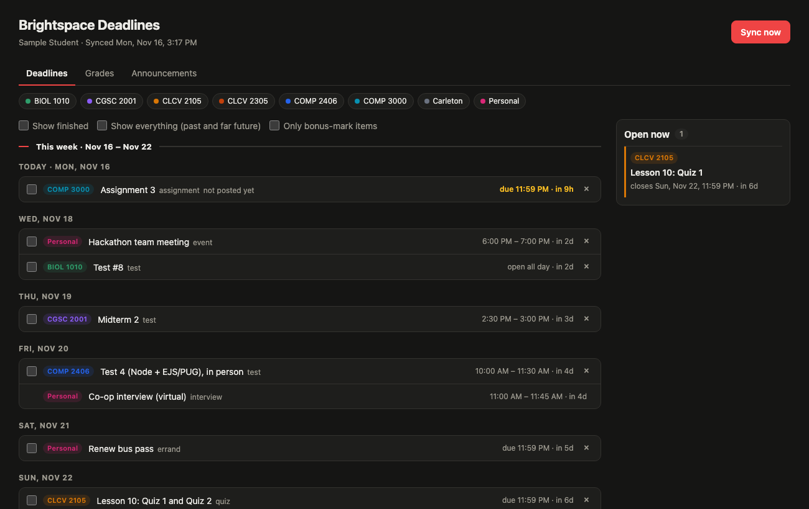
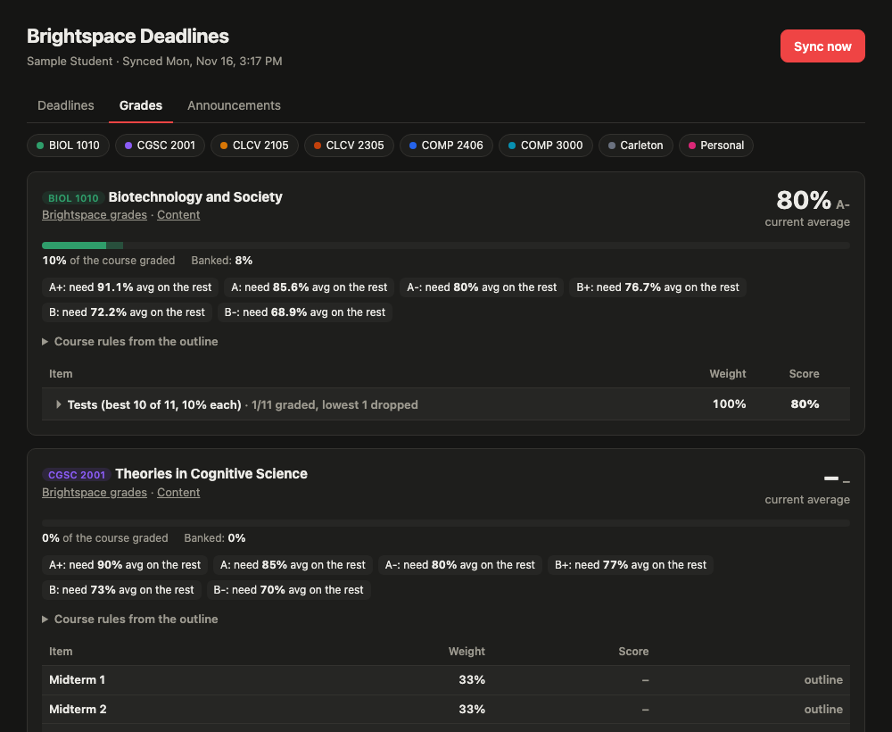
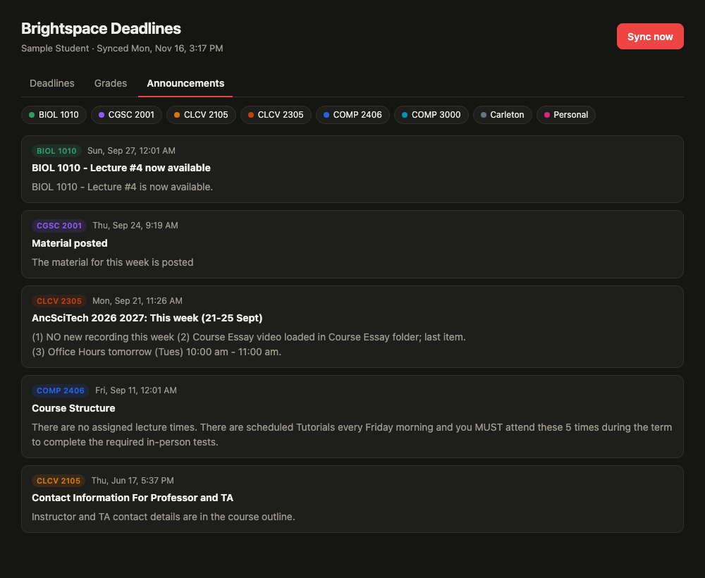
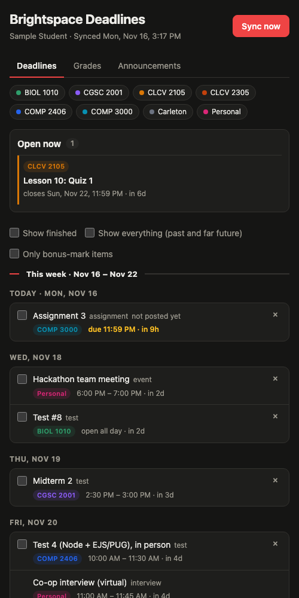

# Brightspace Deadlines

A Chrome extension that pulls deadlines, grades and announcements from Carleton's Brightspace
into one dashboard, with the rules from each course outline applied on top. It uses the
Brightspace session you're already signed in with, so it never sees your password.

- **Deadlines:** every quiz, assignment and test across your courses on one list, including the
  ones Brightspace doesn't know about (in-person tests, course-website assignments).
- **Grades:** your real average per course, worked out the way the outline says ("best 4 of 5",
  missing weights), plus what you need on the rest for each letter grade.
- **Announcements:** new posts from every course in one feed.
- **Phone:** an optional read-only copy of the dashboard for your phone, synced through a private
  GitHub repo.



<sub>Screenshots use made-up sample data.</sub>

## Contents

1. [Quick start](#quick-start)
2. [Using the dashboard](#using-the-dashboard)
3. [Setting up your courses](#setting-up-your-courses)
4. [Starting a new term](#starting-a-new-term)
5. [Phone](#phone)
6. [Keeping your data private](#keeping-your-data-private)
7. [Troubleshooting](#troubleshooting)
8. [Development](#development)

## Quick start

You need Google Chrome (or another Chromium browser) and a Carleton Brightspace account.

1. **Get the code.**

   ```bash
   git clone https://github.com/Siddigz/brightspace-deadlines.git
   cd brightspace-deadlines
   ```

2. **Create your own course file** from the example:

   ```bash
   cp src/courses.example.js src/courses.js
   ```

   `src/courses.js` is where your courses and personal deadlines live. Git ignores it, so it never
   leaves your computer. The example is a real six-course Fall 2026 setup. It works as-is, and you
   can make it yours later ([Setting up your courses](#setting-up-your-courses)).

3. **Load the extension.** Open `chrome://extensions`, turn on **Developer mode** (top right),
   click **Load unpacked** and pick the `brightspace-deadlines` folder.

4. **Pin it.** Click the puzzle-piece icon in Chrome's toolbar and pin **Brightspace Deadlines**.

5. **Sign in to Brightspace** in a normal tab (https://brightspace.carleton.ca), if you aren't
   already.

6. **Open the dashboard** by clicking the extension's icon, then press **Sync now**. Your
   courses, deadlines, grades and announcements appear within a few seconds.

Courses come from the ones **pinned** on your Brightspace homepage, so pin your current courses
there first.

## Using the dashboard

### Syncing

The dashboard syncs on its own:

- when you open it, if the last sync is more than 10 minutes old
- every 3 hours in the background, while Chrome is open
- whenever you press **Sync now**

The line under the title says when it last synced. The number on the extension's icon counts
unfinished items due in the next 48 hours.

### Deadlines tab

1. **Read it top to bottom.** Work that's late but still accepted comes first in red, with the
   penalty and the cutoff. Next is **Overdue**, then one section per day.
2. **Tick an item** when you've done it. Most items tick themselves: anything Brightspace shows a
   submission or grade for counts as done.
3. **Hide an item** you don't care about with **×**. **Unhide N hidden** at the top brings them
   all back.
4. **Filter by course** with the course chips under the tabs. Click a chip to hide that course
   everywhere, and click it again to bring it back.
5. **Use the toolbar** to change what's listed:
   - **Show finished:** include ticked items.
   - **Show everything:** include the far past and far future, not just the coming weeks.
   - **Only bonus-mark items:** just the work worth bonus marks (tagged **bonus**).
6. **Add your own deadline:** open **Add a deadline** at the bottom, pick the course, type what
   it is, and set the date (and time, if it has one). Hide it with **×** to remove it.
7. **Check Open now** (the side panel). It lists everything you can work on right now, such as
   quizzes that are open and assignments that are posted, so you can see what's next.

### Grades tab



One card per course:

- **Current average**, counting only what's been graded so far.
- **What you need** on the remaining work for each letter grade.
- **The bar** shows how much of the course you've banked, lost, and what's still to come. Hover
  over it for the numbers.
- **The key rules** from the outline: weights, "best N of M", pass requirements.

If a course says it has no grading scheme yet, add one to `OUTLINES` in `src/courses.js`.

### Announcements tab

New announcements from every course, newest first. The number on the tab counts ones you haven't
opened yet.



## Setting up your courses

Everything about your courses is in `src/courses.js`. Every option has a comment above it in the
file explaining what it does. Here's the order to go through it in:

1. **`COURSE_ORDER`:** your course codes, in the order you want them shown, e.g.
   `['COMP 2401', 'MATH 1104']`. Courses pinned in Brightspace but missing here show up last.
2. **`COURSE_COLORS`:** a colour per course code.
3. **`PERSONAL_DEADLINES`:** your own things that aren't tied to a course, like an interview, a
   club meeting or an errand. Each entry needs a `title`, a `date`, and a `kind`
   (`'interview'`, `'test'`, `'event'` or `'errand'`).
4. **`EXTRA_DEADLINES`:** course deadlines Brightspace doesn't have, like in-person tests or
   assignments posted on a course website. Copy dates from the course outline.
5. **`DUE_OVERRIDES`:** due dates for Brightspace items that have none set.
6. **`LATE_POLICIES`:** work the outline still accepts late, and with what penalty. Anything not
   listed is treated as a hard deadline.
7. **`OUTLINES`:** each course's grading scheme (weights, "best N of M", items Brightspace doesn't
   list yet). This is what makes the Grades tab match the outline.
8. **`SKIP_DEADLINES`**, **`BONUS_DEADLINES`**, **`ONE_AT_A_TIME`** and **`COURSE_SITES`** are
   optional. The comments in the file say when you'd want them.

Dates are local time: `'2026-10-15T14:30'`, or a bare `'2026-10-15'` for 11:59 PM that day.

**After any change:** go to `chrome://extensions` and click the reload icon on the
Brightspace Deadlines card, then press **Sync now**. To catch typos, run `npm test`.

## Starting a new term

1. Pin the new term's courses on your Brightspace homepage (and unpin the old ones).
2. In `src/courses.js`, replace `COURSE_ORDER`, `COURSE_COLORS` and `OUTLINES` with the new
   courses, and clear out last term's `EXTRA_DEADLINES`, `DUE_OVERRIDES` and `LATE_POLICIES`.
3. Fill them in from each new course outline.
4. If the term dates changed, update `UNIVERSITY_DATES` in `src/config.js` from the Registrar's
   calendar.
5. Reload the extension and press **Sync now**.

## Phone

The phone page is the same dashboard, read-only apart from ticking. It never talks to Brightspace.
After every sync, the extension uploads your data to a **private** GitHub repo of your own. The
phone page reads it from there, and ticks made on either side are merged.

The sign-in page itself is public and holds none of your data: it's just a repo field and a token
field. Your deadlines and grades only ever go to your private repo.

<p align="center"></p>

### Set it up (once)

1. **Make a private repo for your data.** On GitHub, create a new repository, for example
   `brightspace-data`. Set it to **Private** and tick **Add a README** so it isn't empty.
2. **Give it a `data` branch.** On the repo's page, open the branch dropdown (it says `main`),
   type `data`, and choose **Create branch: data from main**. The extension only ever writes to
   this branch.
3. **Make a token.** Go to https://github.com/settings/personal-access-tokens/new and fill it in:
   - **Repository access:** Only select repositories, then pick your data repo.
   - **Permissions:** Contents set to **Read and write**.
   - **Expiration:** pick a long one. When it runs out, make a new token and enter it in both
     places again.

   Copy the token. GitHub only shows it once.
4. **Connect the extension.** Right-click the extension's icon, choose **Options**, enter your
   data repo (`you/brightspace-data`) and the token, and press **Save**. The line under the button
   should change from "Not set up." to "Sharing to you/brightspace-data". If it shows an error
   instead, see [Troubleshooting](#troubleshooting).
5. **Publish the sign-in page.** This step only applies if you forked this repo. In your fork,
   open **Settings → Pages** and set **Source** to **GitHub Actions**. The workflow in
   `.github/workflows/phone-page.yml` publishes `phone-public/` to
   `https://<you>.github.io/brightspace-deadlines/` and republishes it whenever `phone-public/`
   changes.
6. **Open it on your phone.** Go to your Pages URL, enter the same repo and token, then use your
   browser's **Add to Home Screen** (Share → Add to Home Screen on iPhone).

### Day to day

- The phone shows what your laptop last synced. "Laptop synced" at the top says when.
- **Refresh** on the phone re-reads the repo. It doesn't make your laptop sync, so if the data
  looks old, press **Sync now** on the laptop.
- Ticks you make on the phone reach the laptop on its next sync, and the other way round.
- Changes you make to the dashboard's code reach the phone by themselves, because the extension
  uploads the page's code along with your data.

## Keeping your data private

- **`src/courses.js`** (your courses and personal deadlines) is git-ignored. Never rename it,
  move it, or copy its contents into a tracked file.
- **Back it up** somewhere private now and then, for example as a file in your private data repo.
  It exists nowhere else.
- **Ticks and hidden items** are stored in Chrome on your computer, and in your private data repo
  if you use the phone.
- **Check before you commit:** if you change the code, run `git diff --cached` and make sure no
  personal details ended up in a tracked file.

## Troubleshooting

| What you see | What to do |
| --- | --- |
| "Couldn't reach your Brightspace account" | Sign in to Brightspace in a normal tab, then press **Sync now**. |
| A course is missing | Pin it on your Brightspace homepage, then sync. |
| A course is in the wrong place or has no colour | Add it to `COURSE_ORDER` and `COURSE_COLORS` in `src/courses.js`, then reload the extension. |
| "No grading scheme for this course yet" | Add the course to `OUTLINES` in `src/courses.js`. |
| The dashboard says the extension is running old code | Click the reload icon on its card in `chrome://extensions`. |
| Options says "Not set up." | Phone sync was never saved here. Enter your repo and token, then press **Save**. |
| Options shows "GitHub said 401" | The token is wrong or expired. Make a new one. |
| Options shows "GitHub said 403" | The token can't write. Give it **Contents: Read and write** on your data repo. |
| Options shows "GitHub said 404" | Check the repo name, that the token includes that repo, and that the repo has a `data` branch. |
| The phone shows old data | Press **Sync now** on the laptop, then **Refresh** on the phone. |
| The extension stopped working after you moved its folder | Chrome tracks unpacked extensions by folder. Remove it, then **Load unpacked** from the new folder (and set up phone sync again). |

## Development

| File | What it does |
| --- | --- |
| `src/courses.js` | your courses (git-ignored; start from `src/courses.example.js`) |
| `src/config.js` | Carleton-wide settings: Brightspace URL, Registrar dates, letter-grade cutoffs |
| `src/sync.js` | what gets pulled from the Brightspace API |
| `src/coursesite.js` | reads course websites outside Brightspace on each sync |
| `src/grades.js` | the grade math |
| `src/dashboard.js` | the dashboard UI |
| `src/phone.js`, `src/repo.js`, `src/prefs.js` | phone sync and merging ticks |
| `phone-public/` | the public phone sign-in page |

Run the tests:

```bash
npm test
```

Preview the dashboard with sample data, no extension needed:

```bash
npm run preview
```

Then open http://127.0.0.1:5510/dev/preview.html. The phone version is at
http://127.0.0.1:5510/dev/phone-preview.html (sign in as `me/private` with token `good`).

**Another school's Brightspace?** Change `BASE` in `src/config.js` and the Brightspace entry in
`host_permissions` in `manifest.json`. The Registrar dates and letter-grade cutoffs in
`src/config.js` are Carleton's too.
